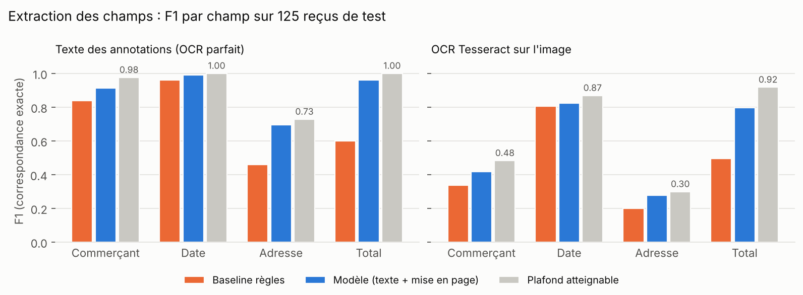
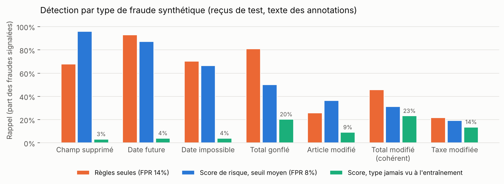

# Contrôle automatique de reçus : extraction d'informations et détection d'incohérences

Pipeline complet qui prend l'image d'un reçu et renvoie :

1. **les champs clés** (commerçant, date, adresse, total), localisés sur l'image ;
2. **des contrôles métier explicables** (total ≠ sous-total + taxe, espèces − total ≠ rendu, date impossible ou future, champs manquants...) ;
3. **un score de risque de 0 à 100**, avec un niveau faible / moyen / élevé calibré sur des reçus authentiques.

Cas d'usage visé : contrôle de notes de frais, KYC documentaire, pré-tri de justificatifs avant revue humaine.

```
image ──► OCR (Tesseract) ──► lignes + boîtes ──► extracteur (texte + mise en page) ──► champs
                                                                    │
                                    structure financière ◄──────────┘
                                    (articles, sous-total, taxe, espèces, rendu)
                                                │
                     13 règles métier ──► écarts ──► score de risque (régression logistique
                                                     + IsolationForest + « surprise » des règles)
```

## Résultats

Tous les chiffres sont mesurés sur **125 reçus de test jamais vus** (split 80/20 fixe, graine 42), et reproduits par `make all`.

### Extraction des champs



F1 en correspondance exacte (protocole SROIE tâche 3 : chaîne identique après normalisation des espaces et de la casse ; total comparé numériquement).

| Entrée | Modèle | Commerçant | Date | Adresse | Total | Macro F1 |
|---|---|---|---|---|---|---|
| Texte des annotations | Baseline règles | 0,840 | 0,960 | 0,461 | 0,600 | 0,715 |
| Texte des annotations | **Modèle** | **0,912** | **0,992** | **0,696** | **0,960** | **0,890** |
| Texte des annotations | *Plafond atteignable* | 0,976 | 1,000 | 0,728 | 1,000 | 0,926 |
| OCR Tesseract | Baseline règles | 0,339 | 0,805 | 0,200 | 0,496 | 0,460 |
| OCR Tesseract | **Modèle** | **0,418** | **0,823** | **0,279** | **0,797** | **0,579** |
| OCR Tesseract | *Plafond atteignable* | 0,483 | 0,869 | 0,299 | 0,918 | 0,642 |

Le **plafond atteignable** est le score obtenu en choisissant parfaitement les bonnes lignes : il mesure ce que l'OCR et les annotations permettent au mieux. Avec le texte des annotations, le modèle est à 4 points de ce plafond ; avec Tesseract, l'écart restant vient surtout de l'OCR.

**Analyse des erreurs** (`reports/extraction_errors.csv`, une ligne par champ faux et sa catégorie) :
- **Adresse** : sur 38 erreurs avec le texte des annotations, 32 sont la bonne ligne avec un texte légèrement différent de la vérité terrain (virgule, espace : « 27,JALAN » contre « 27, JALAN »). La similarité de caractères moyenne est de 0,985 ; c'est la métrique exacte qui est sévère, pas le modèle.
- **Total** : les 5 erreurs restantes sont des confusions de ligne (sous-total, montant arrondi, montant hors taxe).
- **Avec Tesseract**, la cause dominante change : le champ n'est simplement pas lisible dans l'OCR (17 commerçants, 15 totaux, 10 dates absents ou déformés). Améliorer l'OCR (PaddleOCR, prétraitement) rapporterait plus que changer de modèle.

### Détection de fraude

Il n'existe pas de jeu public de reçus frauduleux étiquetés. Les fraudes sont donc **simulées** sur des reçus authentiques, avec 7 manipulations typiques (`src/receiptfraud/fraud_synth.py`) :

| Type | Manipulation |
|---|---|
| Total gonflé | le total affiché est multiplié (×1,15 à ×3) ; sous-total, taxe, espèces et rendu restent d'origine |
| Total modifié (cohérent) | toutes les occurrences du total sont modifiées, et l'espèce versée ajustée : fraude « soignée » |
| Article modifié | le montant d'un article change sans que le total suive |
| Taxe modifiée | le montant de GST/SST change |
| Date impossible | 30/02, 31/02, mois 13 à 15 |
| Date future | année entre 2028 et 2035 |
| Champ supprimé | l'en-tête du commerçant ou la date est retiré |



Résultats sur les reçus de test (125 authentiques, 737 falsifiés avec le texte des annotations ; 603 avec Tesseract) :

| Entrée | ROC-AUC | Seuil « moyen » : faux positifs / rappel | Seuil « élevé » : faux positifs / rappel | Règles seules : faux positifs / rappel |
|---|---|---|---|---|
| Texte des annotations | 0,832 | 8,0 % / 58,8 % | 0,8 % / 41,8 % | 14,4 % / 60,9 % |
| OCR Tesseract | 0,746 | 17,6 % / 50,4 % | 6,4 % / 31,7 % | 36,8 % / 65,0 % |

Les seuils sont fixés sur les reçus authentiques d'entraînement (10 % et 3 % de faux positifs visés), puis appliqués tels quels au test. À taux de faux positifs égal à celui des règles seules, le score détecte 65,5 % des fraudes contre 60,9 % (texte des annotations) et 71,0 % contre 65,0 % (Tesseract).

Contribution de chaque composant (ROC-AUC, texte des annotations) : IsolationForest seul 0,781, « surprise » des règles seule 0,796, modèle complet 0,832.

**Test bout en bout sur images retouchées** (`scripts/eval_image_tampering.py`) : la falsification est reportée sur l'image (zone effacée, nouveau texte dessiné), puis l'image repasse par Tesseract et toute la chaîne.

| Type | n | Signalé (risque moyen ou élevé) | ROC-AUC contre authentiques |
|---|---|---|---|
| Authentiques | 125 | 17,6 % | — |
| Date future | 125 | 80,0 % | 0,884 |
| Date impossible | 124 | 57,3 % | 0,743 |
| Total gonflé | 84 | 27,4 % | 0,681 |
| Total modifié (cohérent) | 125 | 28,0 % | 0,623 |
| Article modifié | 66 | 21,2 % | 0,629 |

### Ce que ces chiffres disent (et ne disent pas)

- **Les fraudes de date et de structure sont bien détectées**, les **fraudes arithmétiques beaucoup moins**. La raison est mesurable : sur les reçus *authentiques* d'entraînement (annotations et Tesseract confondus), « somme des articles ≠ total » se déclenche sur 31 % des reçus et « total ≠ sous-total + taxe » sur 14 %, surtout à cause de la lecture des colonnes quantité/prix et des erreurs d'OCR (fréquences par règle dans `reports/fraud_metrics.json`). Un écart arithmétique est donc un signal faible tant que la lecture des articles n'est pas fiable.
- **Le modèle appris ne généralise pas à un type de fraude jamais vu** (barres vertes : de 3 % à 23 % de rappel). Il apprend quels symptômes accompagnent chaque manipulation simulée. Les règles seules, elles, détectent l'inédit, mais avec deux fois plus de fausses alertes. En production, il faut garder les deux : le score pour prioriser, les règles comme filet de sécurité, et enrichir le catalogue de fraudes simulées à partir des cas réels.
- **Le PR-AUC (0,97) n'est pas un bon indicateur ici** : les fraudes représentent 85 % du jeu de test, ce qui le gonfle mécaniquement. Le taux de faux positifs à rappel donné est la métrique utile pour une équipe de revue.
- Les fraudes sont synthétiques et générées par le même code que celui qui les détecte en partie. Les résultats sont une borne optimiste sur ces 7 manipulations, pas une estimation du taux de détection de fraudes réelles.

## Démo

```bash
python app/app.py        # http://127.0.0.1:5000
```

On dépose une image de reçu (ou on choisit un exemple) : la page affiche le reçu avec les champs encadrés, le score de risque, les champs extraits avec leur confiance, la structure financière lue et la liste des contrôles avec leur explication (par exemple « Espèces 112.48 − total 706.10 = −593.62, rendu lu 6.00 »).

Les exemples de `app/samples/` (deux reçus authentiques, trois retouchés) ont été choisis parmi des cas où la chaîne fonctionne ; ils illustrent le fonctionnement, ils ne mesurent pas la performance.

API JSON :

```bash
curl -F file=@recu.jpg http://127.0.0.1:5000/api/analyze
```

## Installation et reproduction

```bash
pip install -r requirements.txt
sudo apt install tesseract-ocr        # ou : brew install tesseract
make data      # clone SROIE (626 reçus annotés) et lance Tesseract sur toutes les images (~6 min)
make extract   # entraîne l'extracteur, évalue contre la baseline (~2 min)
make fraud     # entraîne le score de risque, évaluations texte et image (~6 min)
make figures
make test      # 11 tests unitaires
```

Tout tourne sur CPU. Données : [SROIE 2019](https://rrc.cvc.uab.es/?ch=13), version corrigée de [zzzDavid/ICDAR-2019-SROIE](https://github.com/zzzDavid/ICDAR-2019-SROIE) (reçus de Malaisie, champs company / date / address / total).

## Comment ça marche

### Extraction (`src/receiptfraud/extract.py`)

SROIE ne donne que la valeur des champs par reçu, pas leur position. `labeling.py` projette donc chaque valeur sur les lignes OCR (recherche floue d'un bloc de lignes contiguës pour le commerçant et l'adresse, égalité de date et de montant pour les deux autres), ce qui produit des étiquettes par ligne.

Chaque ligne est ensuite classée en deux étages, un par champ :
1. **régression logistique sur n-grammes de caractères** de la ligne et de son contexte de rangée (le libellé à gauche du montant : « TOTAL : », « CASH ») ; les prédictions d'entraînement sont faites hors pli pour ne pas surestimer ce signal à l'étage suivant ;
2. **gradient boosting** (`HistGradientBoostingClassifier`) sur ~60 features de mise en page (position, hauteur relative, rang du montant dans le reçu, présence de mots-clés sur la ligne et la rangée...) plus le score texte.

Un décodeur transforme les probabilités par ligne en valeurs : bloc contigu pour le commerçant (avec retrait du numéro d'immatriculation), plus grand groupe de lignes pour l'adresse, meilleure date, montant le plus à droite de la meilleure ligne pour le total.

Le modèle est entraîné sur le texte des annotations **et** sur la sortie Tesseract des mêmes reçus d'entraînement, pour être robuste au bruit d'OCR.

### LayoutLM (`training/layoutlm_finetune.py`)

Un script de fine-tuning de `microsoft/layoutlm-base-uncased` est fourni. Il réutilise les mêmes étiquettes, le même décodeur et les mêmes métriques, donc ses résultats sont directement comparables au tableau ci-dessus. Il demande un GPU (Colab suffit) et n'a pas été exécuté pour ce README : aucun chiffre LayoutLM n'est donc annoncé. C'est la suite naturelle du projet.

### Contrôles et score de risque (`src/receiptfraud/fraud.py`)

`parse_financials` reconstitue la structure du reçu à partir des libellés de chaque rangée (sous-total, taxes et frais de service, remise, arrondi, espèces, rendu, articles) en s'arrêtant au rendu pour ignorer le récapitulatif TVA de bas de ticket. Les 13 règles produisent chacune un indicateur, un écart chiffré et un message.

Le score combine dans une régression logistique :
- les règles et leurs écarts, plus des agrégats indépendants du type de fraude ;
- un **IsolationForest** entraîné uniquement sur des reçus authentiques ;
- la **« surprise » des règles** : pour chaque règle déclenchée, la p-valeur empirique de l'écart observé parmi les reçus authentiques. Cela donne au modèle une mesure de la rareté d'un écart sur de vrais reçus, sans exemple de fraude.

Une règle qui se déclenche avec un écart quasi jamais vu sur un reçu authentique (p ≤ 0,002) fait passer le niveau au minimum à « moyen ».

Les reçus d'entraînement sont extraits **hors pli** (5 plis : l'extracteur n'a jamais vu le reçu qu'il traite), pour que le score apprenne sur des extractions aussi imparfaites qu'en production.

## Structure

```
src/receiptfraud/
  data.py          chargement SROIE, représentation Document / Line
  ocr.py           Tesseract (PaddleOCR en option) -> lignes + boîtes
  textutils.py     montants, dates (dont dates impossibles), normalisation
  labeling.py      projection des étiquettes de champs sur les lignes
  features.py      features de mise en page et de texte
  extract.py       baseline à règles + extracteur appris + décodeur
  metrics.py       précision / rappel / F1 par champ
  fraud.py         structure financière, 13 règles, modèle de risque
  fraud_synth.py   7 générateurs de fraudes (texte) + retouche d'image
  pipeline.py      image -> rapport complet
scripts/           préparation, entraînements, évaluations, figures
training/          fine-tuning LayoutLM (GPU)
app/               démo Flask + exemples
reports/           métriques JSON, analyse d'erreurs CSV, figures
tests/             tests unitaires
```

## Pistes d'amélioration

- **Lire les articles correctement** (quantité × prix unitaire = montant de ligne) : c'est le principal levier pour les fraudes arithmétiques, aujourd'hui noyées dans le bruit.
- **Un meilleur OCR** (PaddleOCR, redressement, binarisation) : l'écart entre « texte des annotations » et « Tesseract » est le plus gros poste de perte, à l'extraction comme à la détection.
- **LayoutLMv3 ou Donut** pour l'extraction, en comparaison directe grâce au script fourni.
- **Analyse forensique de l'image** (Error Level Analysis, incohérences de police ou de compression autour des zones modifiées) : un signal complémentaire, non textuel.
- **Des fraudes réelles**, même peu nombreuses, pour calibrer le score et mesurer la généralisation hors simulation.
